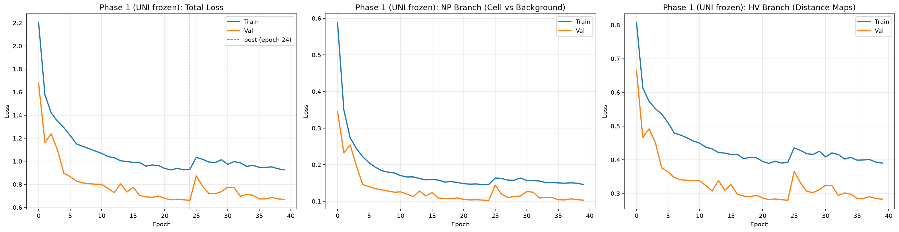
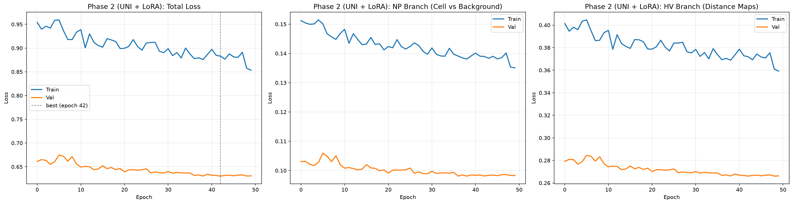
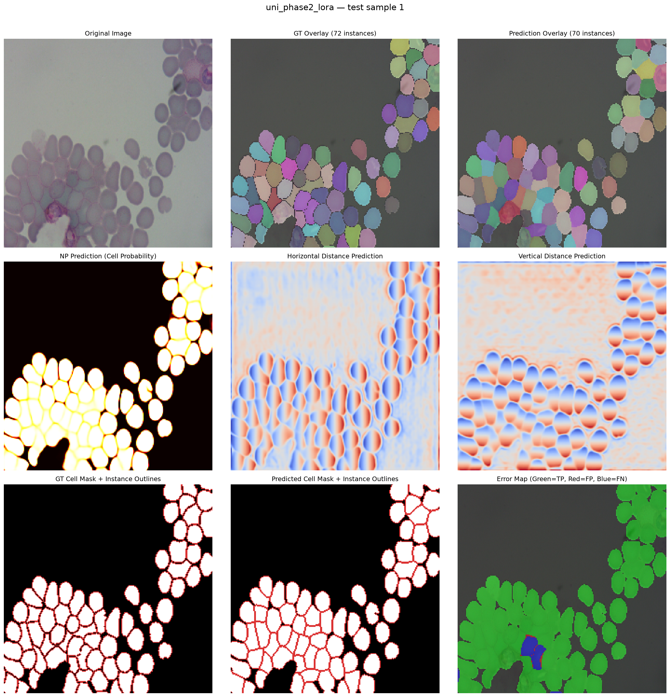
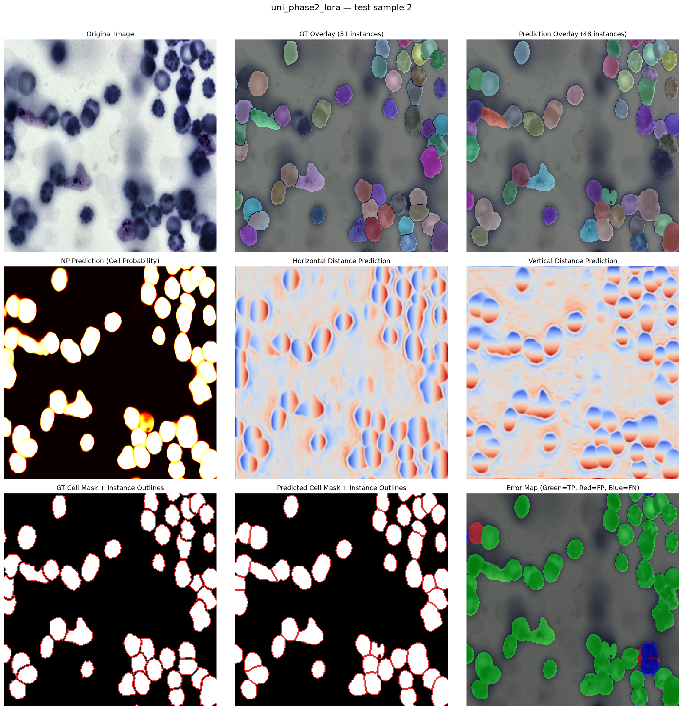
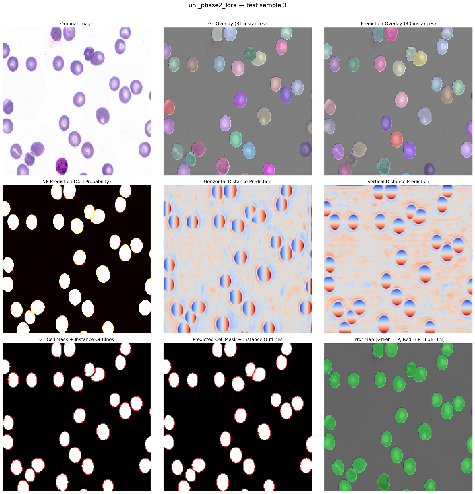
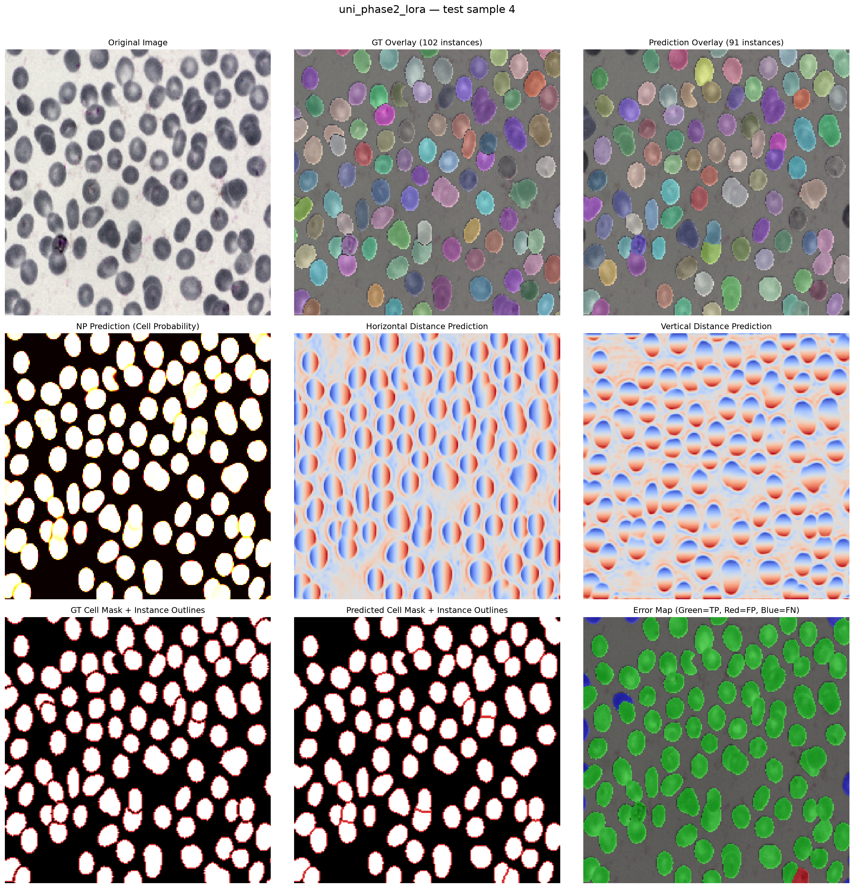
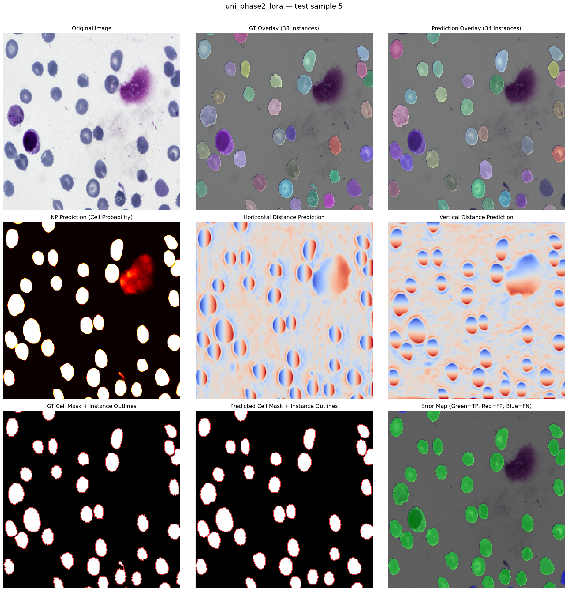

# Results

UNI with LoRA (Phase 2) reaches detection F1 0.910 and panoptic quality (PQ) 0.823 on the 159 test images (224x224 centre crop, 10,386 cells), using the reference HoVer-Net post-processing.

## Test metrics

| Model | FG IoU | FG Dice | Precision | Recall | F1 | SQ | PQ | Count MAE (cells/img) |
|---|--:|--:|--:|--:|--:|--:|--:|--:|
| UNI Phase 1 (frozen) | 0.918 | 0.957 | 0.967 | 0.858 | 0.909 | 0.899 | 0.818 | 7.46 |
| **UNI Phase 2 (LoRA)** | **0.921** | **0.959** | 0.967 | **0.860** | **0.910** | **0.904** | **0.823** | **7.28** |
| ImageNet ViT-L/16 Phase 1 | 0.917 | 0.957 | 0.966 | 0.854 | 0.907 | 0.899 | 0.815 | 7.57 |
| ImageNet ViT-L/16 Phase 2 | 0.919 | 0.958 | 0.967 | 0.855 | 0.907 | 0.902 | 0.818 | 7.60 |

Cells are matched one-to-one at IoU 0.5; F1 equals the recognition quality RQ, and PQ = SQ x RQ. Counts are pooled over the test set. Files: `results/metrics_uni_*.json`, `results/ablation_imagenet/metrics_imagenet_*.json`.

## Backbone comparison

The ImageNet ViT-L/16 was trained with the same code, recipe and seed. Differences are UNI minus ImageNet, with 95% paired-bootstrap intervals over test images (10,000 resamples):

| Phase | PQ | F1 |
|---|---|---|
| Phase 2 (LoRA) | +0.0047 [+0.0020, +0.0073] | +0.0031 [+0.0004, +0.0057] |
| Phase 1 (frozen) | +0.0023 [-0.0001, +0.0048] | +0.0027 [-0.0000, +0.0055] |

UNI is ahead, but by little. Each model was trained once, and both used UNI's input normalisation, so a gain this small may not survive another seed. UNI was pretrained on H&E tissue, not blood smears, which may explain the small margin. LoRA itself added PQ +0.0049 [+0.0031, +0.0069] over the frozen UNI model, mostly through sharper boundaries.

## Post-processing

The notebook's watershed merged touching cells. The same UNI Phase 2 model scores:

| Post-processing | Precision | Recall | F1 | PQ |
|---|--:|--:|--:|--:|
| Notebook watershed | 0.886 | 0.587 | 0.706 | 0.634 |
| Reference HoVer-Net | 0.967 | 0.860 | 0.910 | 0.823 |

The reference version was chosen on the validation split (F1 0.728 -> 0.917) with HoVer-Net's default parameters.

## Training curves

Phase 1 stopped early at epoch 39 (best epoch 24, val loss 0.662). Phase 2 ran all 50 epochs (best epoch 42, val loss 0.630). One RTX 5000 Ada; a Phase 1 epoch took about 15 s.

## Sample segmentations (UNI Phase 2, test set)

Each figure shows the original image next to the ground-truth and predicted instances (top row), the cell-probability and horizontal/vertical distance heatmaps (middle row), and the cell masks with instance outlines and an error map (bottom row: green = correct, red = false positive, blue = missed).

The same samples from the frozen Phase 1 model are in `results/uni_phase1_visualization_sample_*.png`.

## Limitations

- One dataset (BCCD), one fixed split and one training run per configuration.
- Recall is the weak point: 1,453 missed cells against 308 false positives.
- The masks have a single foreground class, so the model does not type cells.
